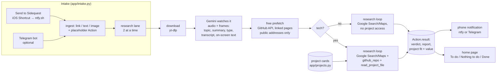
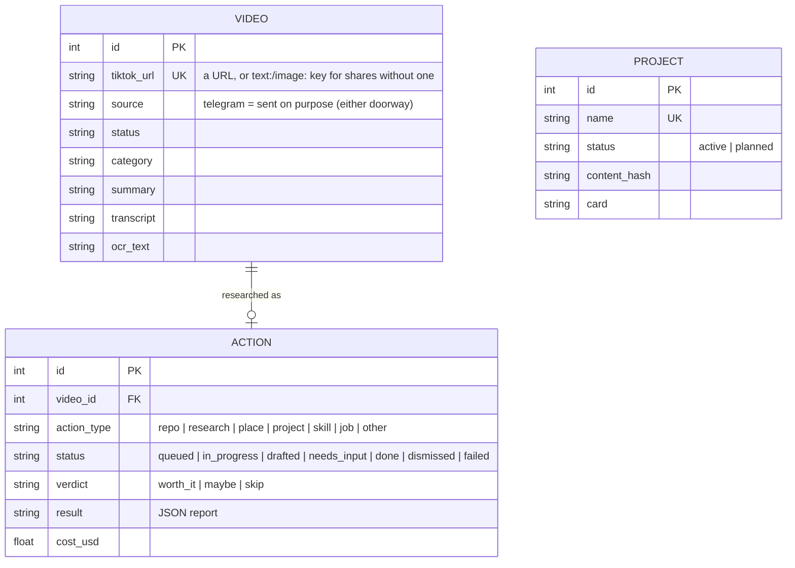

# Architecture

Sidequest takes anything you share from your phone (a TikTok, an Instagram Reel,
a screenshot, a link), has an agent research it within minutes, judges tech
content against your own projects, and puts a next step on a to-do list. This
document covers how it fits together and why; see [README.md](README.md) to run it.

## Pipeline

The archive (`/dashboard`) is the older, read-only library: ~450 TikTok saves
analyzed with Claude Haiku before Sidequest existed.

## Data model

## Key decisions

#### Gemini watches the video; search is effectively free
Research on Claude cost $0.10–0.50 per item, mostly from looping and paid web
searches. Gemini takes the downloaded file itself and processes audio and frames
together, so it reads code, menus and prices on screen with no Whisper/OCR step
(measured $0.009–0.015 per video). Grounded Google Search is free up to 5,000
requests a month on paid Gemini 3 models, and Google Maps grounding covers
places. The video is watched once: that call saves a transcript and on-screen
text, and the research loop (Interactions API, chained server-side by
`previous_interaction_id`) works from that text. Grok and Claude remain
switchable providers behind the same prompts and tools (`app/agent.py`).

#### Only tech content touches your projects
Every project in `~/Projects` gets a short card (purpose, stack, architecture,
pain points, next steps), rebuilt only when its files change. Tech items get the
cards plus a `read_project_file` tool to back up claims about where something
plugs in, and each suggestion is rated for value (fun, personal use + resume,
weak resume, not worth it). Everyday items (food, products, fitness) get a
different prompt and no project tools at all: less to leak, less to pay for.

#### A Shortcut + ntfy as the doorway, long-polled
The share sheet is where the habit already lives, and an iOS Shortcut sits in
it. ntfy.sh relays the share and the app *pulls* from it (as it long-polls
Telegram), so a laptop install needs no public URL, tunnel or open port. The
trade-off is that ntfy topics are secret only by obscurity: topic names are long
and random, every inbound message also carries a token, and the "Research
deeper" button in a notification carries a per-action HMAC, not the token.

#### No login, so the browser is the threat model
The app listens on `127.0.0.1` only, but any website you visit can still point
your browser at it. `app/security.py` refuses requests whose Host isn't ours
(DNS rebinding) and cross-site writes (CSRF), and the CSP blocks third-party
images, because a Markdown image in a report is a prompt-injection
exfiltration channel. Links pulled out of shared content are fetched only if
they resolve to public addresses, re-checked on every redirect (SSRF).

#### Fail visibly, never spend silently
Every share gets an Action card the moment it arrives, so nothing is invisible
while it's being processed. A restart marks interrupted work "Tap Retry" rather
than re-running it, because re-running would spend without being asked. Model
calls retry only briefly; a refused search quota falls back to researching
without search, and errors shown to you are plain-language (details go to the log).

#### SQLite in rollback-journal mode, not WAL
The research lane, background rescans and the web app share one SQLite file.
WAL would allow more concurrency, but its shared-memory index doesn't work across
Docker Desktop's file sharing: opening the database from the host while the
container ran deleted the live WAL file and silently lost writes. Instead each
writer commits promptly (project rescans never hold a write while waiting on a
model call) and connections wait out short locks.

#### Separate `Action` table, not columns on `Video`
`Video` is the stable library table; the research workflow changes shape often.
Keeping it separate means that churn never touches the library's history.

## Testing

No test calls a real service: Gemini, Grok, Claude, Telegram, ntfy and GitHub are
faked with `httpx.MockTransport` or small fake SDK clients, so the suite runs
free and offline. Beyond the logic, it covers the security boundaries (foreign
Host, cross-site posts, private-address fetches, image stripping, secret
scrubbing, a corrupt secrets file) and the failure paths (rate limits, dropped
connections, blocked downloads, restarts). CI runs `ruff`, the suite and a Docker
build on every push.
