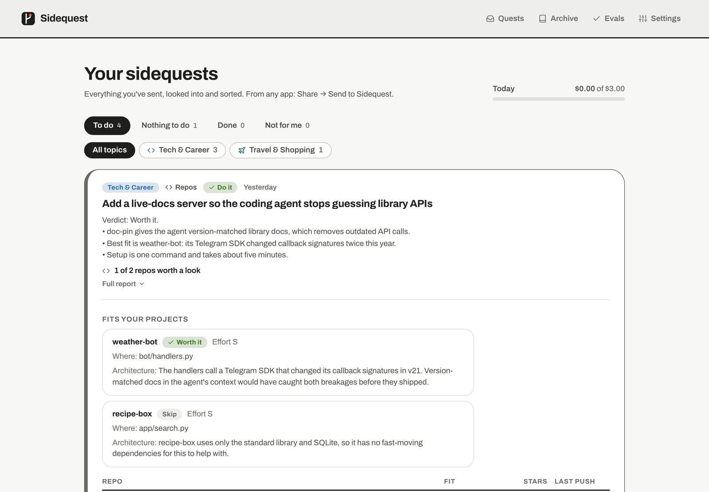

# Sidequest (Saved Video Intelligence)

[](https://github.com/mattthomas7641/saved-video-intelligence/actions/workflows/ci.yml)
[](LICENSE)


Send it anything you come across (a TikTok, an Instagram Reel, a YouTube Short,
a link or a screenshot) and a research agent does the follow-up within minutes
and puts a clear next step on your **To do** list, so you actually act on it
instead of it sitting in your saves. A researched video costs about $0.03–0.06;
links and screenshots cost less.



- **New tools and agent skills, judged against your own projects.** The agent
  reads your project code and tells you whether a tool is worth adopting, where
  it would plug in and what it would change. Repos named in a video are checked
  against the live GitHub API.
- **Everything else, too.** AI news is traced to its source. A food video becomes
  an address, hours and the best day to go. Products get real prices and red
  flags such as paid promotions.
- **It follows through, with your OK.** A food spot comes back with the menu and
  prices, how to book, and 2–3 times you're free; one tap puts it in your
  calendar. A tool that fits a project comes with the GitHub issue to open there,
  opened only when you approve it. A story that's still developing gets checked
  again in a week or a month, and you hear about it only if something changed.
- **Ask it anything in Telegram.** Plain messages go to a general assistant with
  tools: Google Search and Maps, live flight search (Kiwi.com's MCP server, with
  booking links), award seats and card transfer partners (seats.aero's MCP
  server), your saved items, reminders, calendar proposals, fare and price
  watches. "Cheapest flight to Miami on the 20th, and what can I do with 142k
  Chase points?" costs about a cent. It never books, buys or sends on its own:
  you get the link or an approve button.
- **Teams of agents when a request splits.** "Compare three laptops for coding
  under $1,200", "plan a birthday dinner for six next Saturday", "plan a
  weekend in Montreal, I have Chase points": a planner splits the request into
  2–5 independent parts, a specialist agent takes each one with only the
  read-only tools it needs, they run in parallel, and a coordinator merges the
  results. Simple questions stay with one agent. For trips the team was
  measured against a single agent and lost on cost and speed at equal quality
  (below), so trips use one agent.
- **Trips and flight deals.** Send a booking confirmation and each flight gets a
  one-tap calendar event, a check-in reminder 24 hours before and a status check
  on the day, alongside the places you've saved in that city. Send a "cheap
  flights to Tokyo" post and it's checked against live fares; if it isn't a buy
  yet, it watches the price and tells you when it drops.
- **A to-do list that makes you follow through.** Each result arrives as a phone
  notification and stays on the To do list with its next step (try, build, buy,
  go or skip) until you mark it done or "not for me".
- **Usable from other agents.** Sidequest is an MCP server: Claude Code or any MCP
  client can search what you've sent, read reports and send new things in.
- **The archive.** About 450 older TikTok saves analyzed before Sidequest stay
  browsable under **Archive**.

See [ARCHITECTURE.md](ARCHITECTURE.md) for the pipeline and data-model diagrams
and the reasoning behind the bigger design decisions.

**Self-hosted and single-user by design**: your own copy, your own API key, your
data on your own machine. No central service downloads anyone else's content.

## How it works

```
Share → Send to Sidequest (iOS Shortcut)  ─┐
Share → Telegram bot (optional)           ─┴─> intake ─> research lane (2 at a time)
   download (yt-dlp) ─> Gemini watches it (audio + frames) ─> free prefetch (GitHub, linked pages)
   ─> tech or everyday? ─> research loop (Google Search/Maps + your project files, tech only)
   ─> report on the home page + a phone notification
```

1. **Send anything** from a share sheet: TikTok, Instagram Reels, YouTube, X,
   Safari, Photos or a screenshot. Video links are downloaded; if a site blocks
   the download, the report says so and judges the link instead. Screenshots are
   OCR'd and shown to the model; links and text are read as they are. Calls to
   action ("comment X and I'll DM you", link in bio, courses) are ignored.
2. **Gemini watches it** (`gemini-3.8-flash`): one call takes in audio and frames,
   so it reads code, menus and prices on screen, and saves a transcript and the
   on-screen text. Measured: about $0.006–0.015 per video.
3. **The research loop** combines Google Search, plus Google Maps for places
   (free up to 5,000 grounded requests a month on paid Gemini 3 models), with
   the app's own tools:
   live GitHub lookups, reading your project files (tech content only) and filing
   the report. It works from the saved text, so the video is paid for once.
   Measured: about $0.006–0.05 per item, about $0.03 on average. A daily cap
   (default $3) stops it.
4. **Tech content** is judged against your projects: where it would plug in, what
   it changes in the architecture, the effort, and how much it is worth doing.
   **Everyday content** (food,
   products, fitness, money, travel) gets a practical review instead: real prices,
   red flags, alternatives, and the next step. It never touches your projects.
5. **Act on it.** The home page sorts results by topic into **To do**, **Nothing
   to do** (looked into, nothing to act on), **Done** and **Not for me**.
6. **Follow-through** (`app/quests.py`). A report can propose next steps, each a
   durable task: calendar slots (they avoid your busy times if you connect a
   calendar's secret iCal address, read-only, and only busy *times* reach the
   model), a GitHub issue for the project it fits, or a scheduled check-back.
   Anything that changes something outside Sidequest waits for your tap, on the
   report or on the notification itself. Check-backs only read the web, cost
   about a cent, and run on Gemini's half-price Flex tier.

Grok and Claude can be switched in for research in Settings; they work from a
Whisper transcript and OCR instead of watching the video.

### Measured: model comparison

The same 12 real cases from the eval set, run on two setups (`python -m app.evals table`).
Expected answers are the agent's earlier reports, so the scores measure agreement
with those, not ground truth; at 12 cases one case is about 8 points.

| Setup | Type | Verdict | Verdict ±1 | Ignores CTAs | Projects found | $/case | Median time |
|---|---|---|---|---|---|---|---|
| Gemini 3.8 Flash, standard | 75% | 58% | 92% | 92% | 58% | $0.041 | 80 s |
| Gemini 3.5 Flash-Lite, Flex | 67% | 50% | 83% | 100% | 58% | $0.004 | 46 s |

Flash-Lite on Flex costs a tenth as much for roughly one case in twelve worse, so
background checks use it by default and Settings offers it for new shares.

### Measured: one agent vs a team of agents (trip planning)

Five trip requests (Miami, Chicago, Montreal with points, Nashville, Denver with
points), each planned by one agent with every tool and by four specialists in
parallel plus a coordinator (`python -m app.trip_eval`):

| Setup | Plans | Judge grade (1-5) | Checks passed | $/plan | Median time |
|---|---|---|---|---|---|
| One agent, all tools | 5 | 5 | 100% | $0.014 | 26 s |
| 4 specialists in parallel + coordinator | 5 | 5 | 100% | $0.029 | 48 s |

Same quality, twice the cost, and slower: the coordinator is an extra
sequential call and each specialist repeats context. So trips run as one
agent, and the team is kept for broad requests the planner decides to split.
Caveats: five cases, and the judge (Flash-Lite, absolute 1-5) gave every plan
a 5, so it can't separate them; a stricter pairwise judge is the next step.

### Traces, memory, evals and MCP

- **Every paid call is traced.** Each attempt (watching, research, project
  cards) is one row in a run ledger: its model calls, tool calls and searches in
  order, with timings, tokens and cost. Each report links to its trace
  (`/runs/<id>`), and the daily cap sums the ledger, so failed attempts and
  retries count too.
- **Memory across shares.** Each finished report is embedded once
  (`gemini-embedding-2`, well under $0.001 an item). Before researching something
  new, the three most similar past reports are handed to the agent as "things you
  sent before", so it builds on them instead of repeating itself, and the report
  links them. **Settings → Memory** backfills older reports.
- **An eval set from your own history.** **Evals** turns items you've already
  sent into test cases (the expected type, tech/everyday split, verdict and
  projects), which you can correct. A run re-researches each case with the
  current prompts and models and scores type, verdict, project matches, ignored
  calls to action and report format, so a prompt or model change shows up as a
  number. Runs are manual, capped (an estimated $0.03–0.05 a case) and kept off the
  daily cap; cases live only on your machine. `python -m app.evals run
  --watch-model … --research-model … --tier flex` runs the same cases on another
  setup, and `python -m app.evals table` compares every run side by side.
- **Standard traces.** Set `OTEL_EXPORTER_OTLP_ENDPOINT` and every run is also
  exported as OpenTelemetry spans (GenAI semantic conventions: `invoke_agent`,
  `chat`, `execute_tool`), so it opens in Langfuse, Phoenix or Jaeger.
- **MCP server** (`app/mcp_server.py`). Tools: `list_sidequests`, `get_report`,
  `search_sidequests`, `upcoming`, `send_to_sidequest`. Locally it runs inside
  the container over stdio, so nothing is exposed:

  ```bash
  claude mcp add sidequest -- docker compose -f "$PWD/docker-compose.yml" exec -T app python -m app.mcp_server
  ```

  Over the network it's at `/mcp/` behind a bearer token from Settings. No tool
  can approve follow-through; that stays with you.

## Setup

Requirements: Docker Desktop, an iPhone for the Shortcut (or Telegram), and a
[Gemini API key](https://aistudio.google.com/apikey) **with billing on** (video
input and Google Search aren't on the free tier).

```bash
cp .env.example .env        # required by docker compose; the defaults are fine
docker compose up -d --build
```

Open `http://127.0.0.1:8790/settings`, then:

1. **Send to Sidequest:** click **Create my private channel** and follow the steps
   shown (subscribe in the free ntfy app, build the 2-minute Shortcut).
2. **Research agent:** paste the Gemini key, fill in **About me** (what you're
   building, where you live: it's what makes "useful for you" mean something),
   and list ideas you haven't started yet.
3. **Your projects:** found in `~/Projects` (`PROJECTS_DIR`), mounted read-only.
   Mark each one active, planned or ignored. Project folders that are symlinks to
   elsewhere need their targets mounted too: list them in a git-ignored
   `docker-compose.override.yml`.
4. **Follow-through** (optional): your calendar's secret iCal address, so
   suggested times avoid busy ones; a fine-grained GitHub token with Issues
   read/write on your own repos, used only when you approve an issue; your home
   airport and a free SerpApi key for live flight fares.

To use a different port, start it with `SIDEQUEST_PORT=<port> docker compose up -d`.

To use it from your phone, put the Mac and phone on one
[Tailscale](https://tailscale.com) network, run `tailscale serve --bg 8790`, and
set `PUBLIC_BASE_URL` to the `https://….ts.net` address so notification links open
the report.

## Security model

The app has no login: it only listens on `127.0.0.1` and assumes you are the one
using it. Things that could still reach it are handled explicitly:

- **Other websites in your browser** (CSRF, DNS rebinding): only our own Host is
  served, cross-site writes are refused, and a CSP blocks third-party images and
  framing (`app/security.py`).
- **Hostile content in what you send**: links found in videos are fetched only if
  they resolve to public addresses (re-checked on every redirect); reports can't
  load images (a prompt-injection exfiltration route); project files the agent
  reads go through a deny-list (no `.env`, `secrets/`, `data/`, keys, binaries,
  symlink escapes) and have credential-shaped strings scrubbed.
- **The relay**: ntfy topic names are long and random, every inbound message needs
  a secret token, and notification buttons ("Research deeper", "Open the issue",
  a calendar slot) carry a signature for that one action, not the token.
- **Acting on your behalf**: nothing outside Sidequest changes without your tap.
  The GitHub token is yours to scope (Issues only); the calendar is read-only by
  construction (an iCal feed) and event titles never leave the app; MCP tools
  can't approve anything. Telegram answers one paired chat; pairing codes expire in 10 minutes.
- **Secrets** live in `data/secrets.json` (0600, atomic writes, never overwritten
  if unreadable) and never appear in logs or error messages.
- **Dependencies** are pinned; `pip-audit` reports no known vulnerabilities.

Hosting it publicly would additionally need authentication, secrets from the
environment, HTTPS and project cards built from GitHub instead of local folders.

## Testing

```bash
.venv/bin/python -m pytest      # isolated temp DB and secrets, never touches data/
.venv/bin/ruff check .
.venv/bin/pip-audit -r requirements.txt
```

No test calls a real API: Gemini, Grok, Claude, Telegram, ntfy and GitHub are
faked (`httpx.MockTransport`, fake SDK clients), so the suite is free and offline.
CI runs lint, the tests (367), `pip-audit`, a Docker build and a container
smoke test on every push and pull request.

## Project layout

```
app/
  main.py            FastAPI routes: home (sidequests), archive, video page, settings,
                     run traces, evals, health
  config.py, db.py, models.py, schemas.py   Settings, database session, tables, schemas
  security.py        Host/cross-site guard and security headers
  intake.py          Shared intake + research lane (both doorways)
  ntfy_intake.py     "Send to Sidequest" Shortcut doorway (ntfy relay) + notifications
  telegram_bot.py    Optional Telegram doorway
  pipeline.py        One shared item: download -> watch -> research -> result
  gemini_client.py   Gemini: watch + research loop (default provider)
  xai_client.py      Grok provider;  agent.py: shared prompts, tools, Claude loop
  projects.py        Your projects: scan, cards, secret-safe file reader
  prefetch.py        Free GitHub/page lookups (public addresses only)
  analyze.py         The first-pass analysis schema (topic, summary, type)
  tracing.py         Run traces and the cost ledger behind the daily cap
  memory.py          Embeddings + recall of related past reports
  evals.py           Eval cases, scoring and runs (`python -m app.evals`)
  quests.py          Follow-through: durable tasks, approvals, the scheduler
  calendar_busy.py   Busy times from your calendar's iCal feed; calendar links and .ics
  flights.py         Live Google Flights fares (via SerpApi) for deals and price watches
  assistant.py       The "ask anything" chat agent (Telegram), its tools and profile
  team.py            Multi-agent: planner -> parallel read-only specialists -> coordinator
  trip_planner.py    The trip team preset;  trip_eval.py: team vs single agent, measured
  todoist.py, notion.py   Your tasks and notes, as assistant tools
  mcp_client.py      Allowlisted outside MCP servers (Kiwi.com flights, seats.aero awards)
  mcp_server.py      Sidequest as an MCP server (stdio and /mcp/)
  otel.py            Optional OpenTelemetry export of run traces
  download.py, ocr.py, transcribe.py   yt-dlp, tesseract, Whisper (non-Gemini providers)
  services/dashboard_query.py          The archive's filters and stats
alembic/             Schema migrations
templates/, static/  Jinja2 pages and CSS (no build step)
tests/               pytest suite
data/                SQLite DB, thumbnails, secrets (git-ignored)
```

## License

[MIT](LICENSE)
