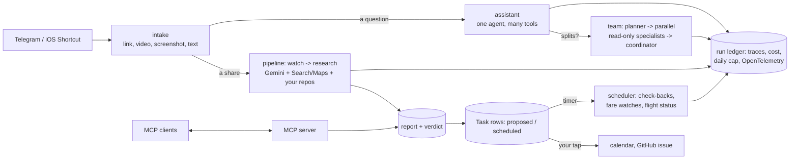

# Sidequest

[](https://github.com/mattthomas7641/sidequest/actions/workflows/ci.yml)
[](LICENSE)


**A personal agent that acts on what you send it: measured, cost-capped, and
never acting outside the app without your tap.**

You come across something (a TikTok, a Reel, a link, a screenshot, a booking
email) and share it to Sidequest. An agent researches it, judges it against your
own projects or your life, and puts a concrete next step on a to-do list. Then it
follows through: a calendar slot for the restaurant, an issue in the repo it
fits, a check-back when the launch happens. I use it daily; it costs me about
$3–5 a month.


## What it does

- **Researches what you share.** Gemini watches the video itself (audio and
  frames, so it reads code, menus and prices on screen), then researches with
  Google Search and Maps. Tech content is judged against your own repositories:
  where it would plug in, what it changes, the effort, and whether it's worth it.
  Everything else gets a practical review: real prices, red flags, the next step.
- **Follows through, with your OK.** Each report can propose next steps as
  durable tasks: 2–3 calendar slots for a place (avoiding busy times read from
  your calendar), a GitHub issue for the project it fits, a fare watch, or a
  check-back on a developing story that messages you only if something changed.
  Reading is automatic; anything outward-facing waits for a tap.
- **Answers anything over Telegram.** Plain messages go to an assistant with
  tools: search and maps, live fares, award seats and card transfer partners,
  everything you've saved, reminders, calendar proposals. Requests that split
  into independent parts go to a team of parallel specialist agents.
- **Works with other agents.** It uses outside MCP servers (Kiwi.com flights,
  seats.aero awards) through a pinned allowlist, and is an MCP server itself, so
  Claude Code can search what you've sent and read your reports.

## How it fits together



Details and the reasoning behind each choice: [ARCHITECTURE.md](ARCHITECTURE.md).

## Measured

Every paid call is a traced, costed run, so these numbers come from the ledger.
Answers are compared head to head by a judge model, asked twice with the order
swapped; a win counts only when both rounds agree (`app/judge.py`).

**Which model writes the reports** (12 real cases from my own history):

| Setup | Head-to-head wins | Type correct | Verdict within one | $/item | Median time |
|---|---|---|---|---|---|
| Gemini 3.8 Flash | **10** (1 tie) | 75% | 92% | $0.041 | 80 s |
| Gemini 3.5 Flash-Lite on Flex | 1 | 67% | 83% | $0.004 | 46 s |

**One agent or a team, for trip planning** (5 trip requests):

| Setup | Head-to-head wins | $/plan | Median time |
|---|---|---|---|
| One agent with every tool | 1 (1 tie) | $0.014 | 26 s |
| 4 parallel specialists + coordinator | **3** | $0.029 | 48 s |

Small samples (12 and 5), so these steer decisions rather than prove them.

## Decisions the data changed

- **Multi-agent, reversed twice.** An absolute 1–5 judge gave every trip plan a 5,
  so the team looked like pure cost and I switched trips to one agent. A pairwise
  judge then preferred the team's plans 3–1: worth 1.5¢ for a trip, not for a
  quick question. Trips use the team; simple questions never pay for one, because
  the planner can answer "no team".
- **The cheap model isn't free.** Flash-Lite's per-field scores trailed by about
  one case in twelve, but head to head it lost 10 of 12. It runs the background
  yes/no checks, not the reports.
- **An eval caught a pricing bug.** Kiwi.com's flight search returns euros by
  default; fares were being shown as dollars until a trip eval surfaced it.
- **Repeats cost nothing.** The same item sent twice returns its earlier report;
  a near-duplicate (memory similarity ≥ 0.88) asks before paying again.
- **SQLite without WAL.** Reading the database from the host while Docker ran
  silently lost writes through WAL's shared-memory file; rollback-journal mode
  with prompt commits fixed it.
- **No images in reports.** A Markdown image is a prompt-injection channel for
  smuggling data out in a URL, so model output can't load any.

## Engineering

- **Reliability:** every failure ends visible and retryable; follow-through is
  durable (`Task` rows claimed with a conditional update so nothing runs twice;
  interrupted tasks recover on restart); model calls retry briefly and fall back.
- **Safety:** outward-facing actions need a tap (signed per task when it's a
  notification button); specialists get read-only tools, enforced where tools run;
  outside MCP servers are allowlisted per tool; links are fetched only if they
  resolve to public addresses; project files go through a secret-safe reader.
- **Cost:** a ledger behind a daily cap, Gemini's half-price Flex tier for
  background work, free search grounding, and repeat detection.
- **Observability:** a trace per run (model calls, tool calls, timings, tokens,
  cost) on the report's trace page and, optionally, as OpenTelemetry GenAI spans.
- **Tests:** offline and free (every API faked), in CI with `pip-audit`, a Docker
  build and a smoke test.

## Setup

Requirements: Docker Desktop, Telegram (or an iPhone for the Shortcut), and a
[Gemini API key](https://aistudio.google.com/apikey) **with billing on** (video
input and Google Search aren't on the free tier).

```bash
cp .env.example .env        # required by docker compose; the defaults are fine
docker compose up -d --build
```

Open `http://127.0.0.1:8790/settings`, then:

1. **Telegram:** create a bot with @BotFather, paste its token, and pair your chat
   with the code shown. (Or **Send to Sidequest**: an iOS Shortcut through a private
   ntfy relay, for people without Telegram.)
2. **Research agent:** paste the Gemini key, fill in **About me** (what you're
   building, where you live: it's what makes "useful for you" mean something),
   and list ideas you haven't started yet.
3. **Your projects:** found in `~/Projects` (`PROJECTS_DIR`), mounted read-only.
   Mark each one active, planned or ignored. Project folders that are symlinks to
   elsewhere need their targets mounted too: list them in a git-ignored
   `docker-compose.override.yml`.
4. **Follow-through** (optional): your calendar's secret iCal address, so
   suggested times avoid busy ones; a fine-grained GitHub token with Issues
   read/write on your own repos, used only when you approve an issue; your home
   airport for flight searches.

To use a different port, start it with `SIDEQUEST_PORT=<port> docker compose up -d`.

To use it from your phone, put the Mac and phone on one
[Tailscale](https://tailscale.com) network, run `tailscale serve --bg 8790`, and
set `PUBLIC_BASE_URL` to the `https://….ts.net` address so notification links open
the report.

**Use it from Claude Code** (runs inside the container over stdio; nothing is exposed):

```bash
claude mcp add -s user sidequest -- docker compose -f "$PWD/docker-compose.yml" exec -T app python -m app.mcp_server
```

**Run the evals** (each spends a little; all are capped):

```bash
docker compose exec app python -m app.evals snapshot          # turn past shares into cases
docker compose exec app python -m app.evals run --max-usd 1   # re-research them, score, save
docker compose exec app python -m app.trip_eval run           # one agent vs the team
docker compose exec app python -m app.judge trips             # head-to-head on saved answers
```

## Security model

The app has no login: it only listens on `127.0.0.1` and assumes you are the one
using it. Things that could still reach it are handled explicitly:

- **Other websites in your browser** (CSRF, DNS rebinding): only our own Host is
  served, cross-site writes are refused, and a CSP blocks third-party images and
  framing (`app/security.py`).
- **Hostile content in what you send**: links found in videos are fetched only if
  they resolve to public addresses (re-checked on every redirect); reports can't
  load images (a prompt-injection exfiltration route); project files the agent
  reads go through a deny-list (no `.env`, `secrets/`, `data/`, keys, binaries,
  symlink escapes) and have credential-shaped strings scrubbed.
- **The relay**: ntfy topic names are long and random, every inbound message needs
  a secret token, and notification buttons ("Research deeper", "Open the issue",
  a calendar slot) carry a signature for that one action, not the token.
- **Acting on your behalf**: nothing outside Sidequest changes without your tap.
  The GitHub token is yours to scope (Issues only); the calendar is read-only by
  construction (an iCal feed) and event titles never leave the app; MCP tools
  can't approve anything. Telegram answers one paired chat; pairing codes expire in 10 minutes.
- **Secrets** live in `data/secrets.json` (0600, atomic writes, never overwritten
  if unreadable) and never appear in logs or error messages.
- **Dependencies** are pinned; `pip-audit` reports no known vulnerabilities.

Hosting it publicly would additionally need authentication, secrets from the
environment, HTTPS and project cards built from GitHub instead of local folders.

## Testing

```bash
.venv/bin/python -m pytest      # isolated temp DB and secrets, never touches data/
.venv/bin/ruff check .
.venv/bin/pip-audit -r requirements.txt
```

No test calls a real API: Gemini, Claude, Telegram, ntfy, Kiwi.com, seats.aero and GitHub are
faked (`httpx.MockTransport`, fake SDK clients), so the suite is free and offline.
CI runs lint, the tests (358), `pip-audit`, a Docker build and a container
smoke test on every push and pull request.

## Project layout

```
app/
  main.py            Actions (approve, done, re-run), settings, traces, evals, health
  web.py             The pages: Tracked (home), Log (search), a page per quest, Ledger
  config.py, db.py, models.py, schemas.py   Settings, database session, tables, schemas
  security.py        Host/cross-site guard and security headers
  intake.py          Shared intake + research lane (both doorways)
  ntfy_intake.py     "Send to Sidequest" Shortcut doorway (ntfy relay) + notifications
  telegram_bot.py    Optional Telegram doorway
  pipeline.py        One shared item: download -> watch -> research -> result
  gemini_client.py   Gemini: watch + research loop (default provider)
  agent.py           Shared prompts, tools, report schema, and the Claude loop
  projects.py        Your projects: scan, cards, secret-safe file reader
  prefetch.py        Free GitHub/page lookups (public addresses only)
  analyze.py         The first-pass analysis schema (topic, summary, type)
  tracing.py         Run traces and the cost ledger behind the daily cap
  memory.py          Embeddings + recall of related past reports
  evals.py           Eval cases, scoring and runs (`python -m app.evals`)
  judge.py           Pairwise, order-swapped judging of two setups' answers
  quests.py          Follow-through: durable tasks, approvals, the scheduler
  calendar_busy.py   Busy times from your calendar's iCal feed; calendar links and .ics
  flights.py         Live fares via Kiwi.com's MCP server, for trips, deals and price watches
  assistant.py       The "ask anything" chat agent (Telegram), its tools and profile
  team.py            Multi-agent: planner -> parallel read-only specialists -> coordinator
  trip_planner.py    The trip team preset;  trip_eval.py: team vs single agent, measured
  mcp_client.py      Allowlisted outside MCP servers (Kiwi.com flights, seats.aero awards)
  mcp_server.py      Sidequest as an MCP server (stdio and /mcp/)
  otel.py            Optional OpenTelemetry export of run traces
  download.py, ocr.py, transcribe.py   yt-dlp, tesseract, Whisper (non-Gemini providers)
alembic/             Schema migrations
templates/, static/  Jinja2 pages and CSS (no build step)
tests/               pytest suite
data/                SQLite DB, thumbnails, secrets (git-ignored)
```

## License

[MIT](LICENSE)
